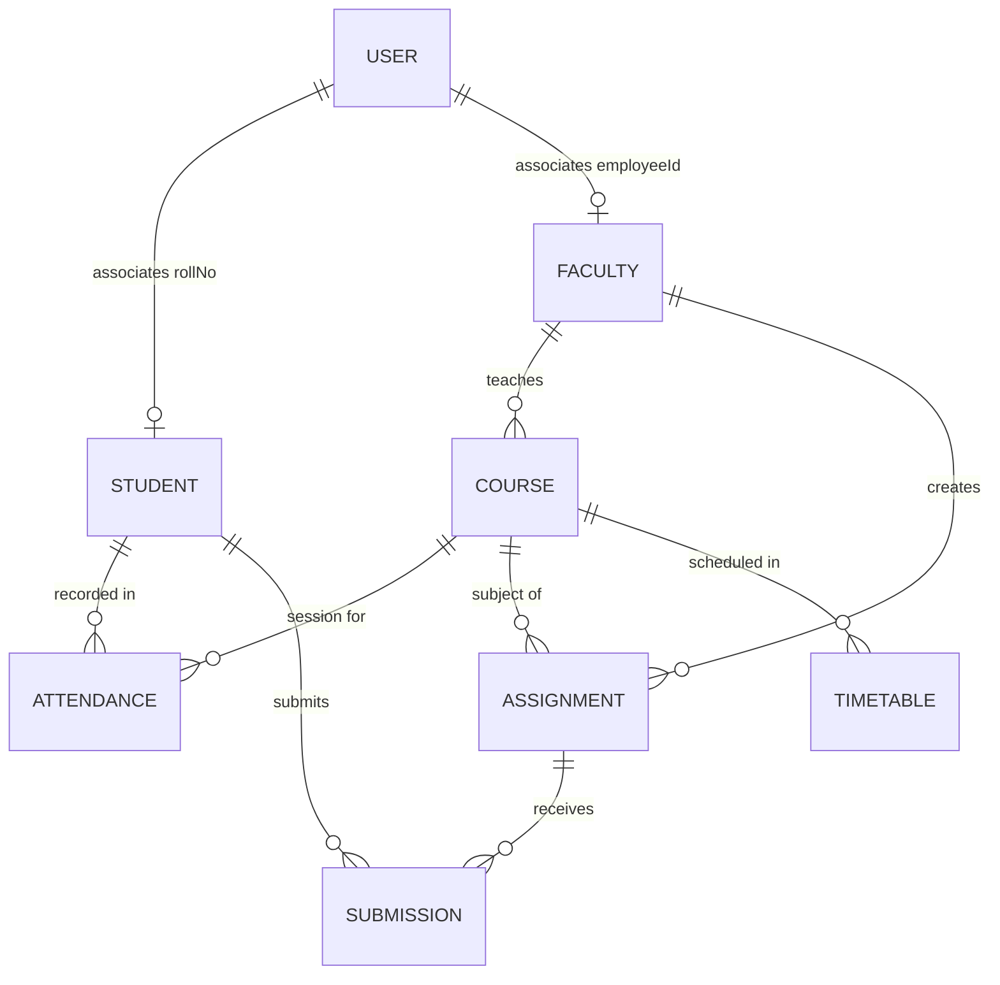

# Database Schema Documentation — Acadexa

Acadexa uses MongoDB with Mongoose ODM to manage high-integrity academic data with unique indexes and cross-collection references.

---

## Collections Overview

---

### 1. `users` Collection
Stores authentication credentials and role assignments.
- `_id`: ObjectId (Primary Key)
- `name`: String (Required)
- `email`: String (Required, Unique, Lowercase)
- `password`: String (Bcrypt Hashed)
- `role`: Enum `["admin", "faculty", "student"]` (Default: "student")
- `rollNo`: String (Optional, for students)
- `employeeId`: String (Optional, for faculty)
- `department`: String
- `className`: String
- `avatar`: String (URL or base64)
- `status`: Enum `["Active", "Inactive"]` (Default: "Active")
- `createdAt` / `updatedAt`: Timestamps

### 2. `students` Collection
Stores comprehensive student records and enrollments.
- `_id`: ObjectId
- `name`: String (Required)
- `rollNo`: String (Required, Unique)
- `course`: String (e.g. "B.Tech CSE")
- `className`: String (e.g. "CSE-A")
- `semester`: Number (1 to 8)
- `email`: String (Required, Unique)
- `phone`: String
- `address`: String
- `status`: Enum `["Active", "Inactive"]`

### 3. `faculty` Collection
Stores teaching staff and departmental designations.
- `_id`: ObjectId
- `name`: String (Required)
- `employeeId`: String (Required, Unique)
- `department`: String (Required)
- `designation`: String (e.g. "Professor", "Associate Professor")
- `email`: String (Required, Unique)
- `status`: Enum `["Active", "Inactive"]`

### 4. `courses` Collection
Stores academic subjects, credits, and faculty assignments.
- `_id`: ObjectId
- `code`: String (Required, Unique, e.g. "BCS501")
- `name`: String (Required)
- `department`: String (Required)
- `semester`: Number (Required)
- `faculty`: String (Assigned professor)
- `credits`: Number (1 to 10)

### 5. `attendances` Collection
Stores class attendance sessions with unique composite index.
- `_id`: ObjectId
- `studentName`: String (Required)
- `rollNo`: String (Required)
- `course`: String (Required)
- `date`: Date (Required)
- `status`: Enum `["Present", "Absent"]`
- **Unique Compound Index**: `{ rollNo: 1, course: 1, date: 1 }`

### 6. `assignments` Collection
Stores homework and project tasks posted by faculty.
- `_id`: ObjectId
- `title`: String (Required)
- `subject`: String (Required)
- `className`: String (Required)
- `dueDate`: Date (Required)
- `description`: String
- `createdBy`: String (Faculty name)

### 7. `submissions` Collection
Stores student answers, grading scores, and faculty feedback.
- `_id`: ObjectId
- `assignmentId`: ObjectId (Ref: "Assignment", Required)
- `studentName`: String (Required)
- `rollNo`: String (Required)
- `answer`: String (Required)
- `submittedAt`: Date (Default: Date.now)
- `marks`: Number (0 to 100)
- `feedback`: String
- `status`: Enum `["Submitted", "Graded"]`
- **Unique Compound Index**: `{ assignmentId: 1, rollNo: 1 }`

### 8. `notices` Collection
Stores campus announcements and administrative circulars.
- `_id`: ObjectId
- `title`: String (Required)
- `content`: String
- `category`: Enum `["Academic", "Examination", "Holiday", "Meeting", "Event", "General"]`
- `date`: Date (Required)
- `audience`: Enum `["All Students", "All Students & Faculty", "CSE Students", "Faculty"]`
- `author`: String (e.g. "Examination Cell")
- `status`: Enum `["Published", "Draft"]`

### 9. `timetables` Collection
Stores weekly class schedule slots.
- `_id`: ObjectId
- `day`: Enum `["Monday", "Tuesday", "Wednesday", "Thursday", "Friday", "Saturday"]`
- `className`: String (e.g. "CSE-A")
- `subject`: String
- `faculty`: String
- `time`: String (e.g. "09:00 AM - 10:00 AM")
- `room`: String (e.g. "Room 201", "Lab 102")
